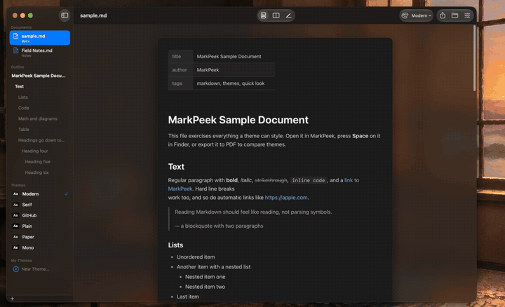
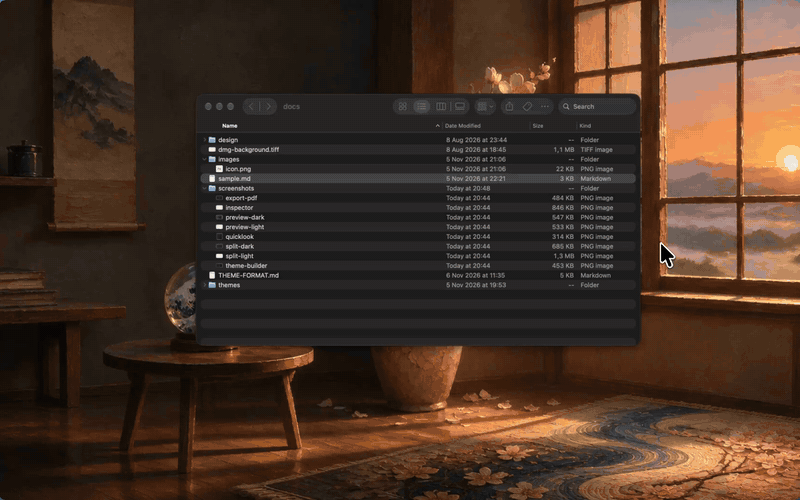
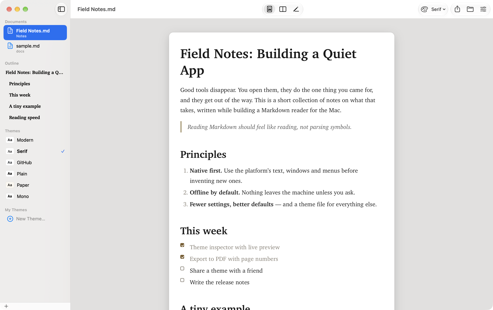
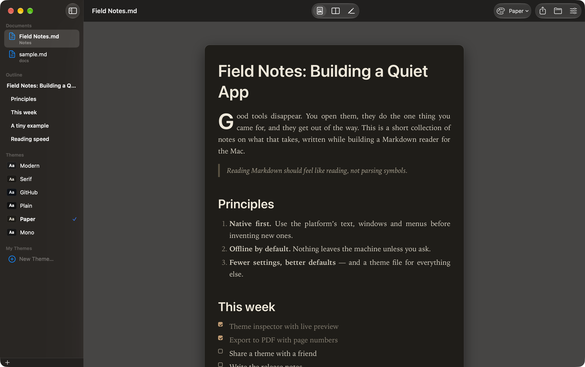
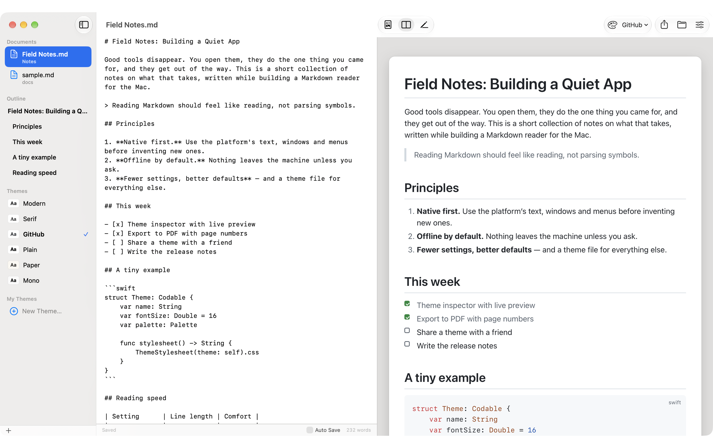
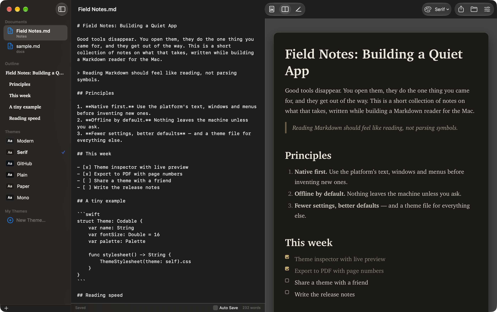
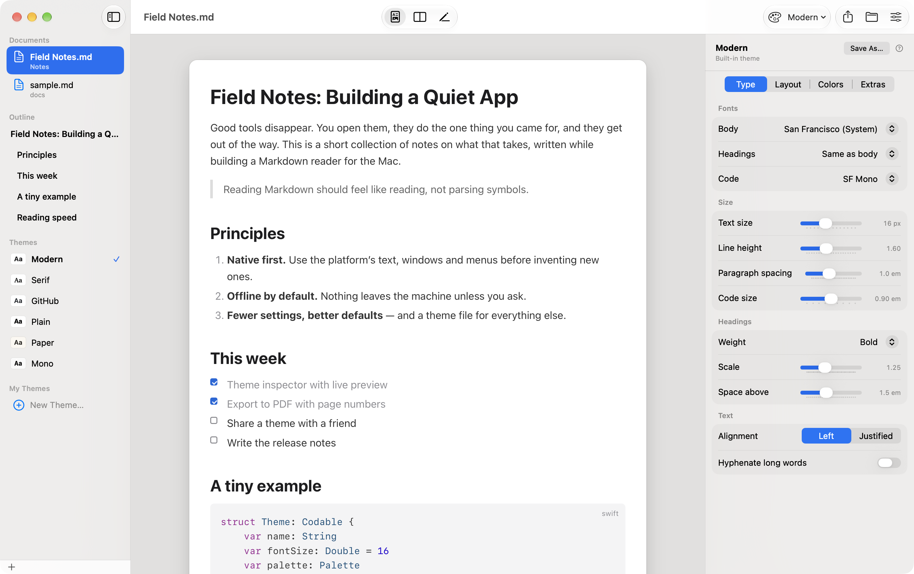
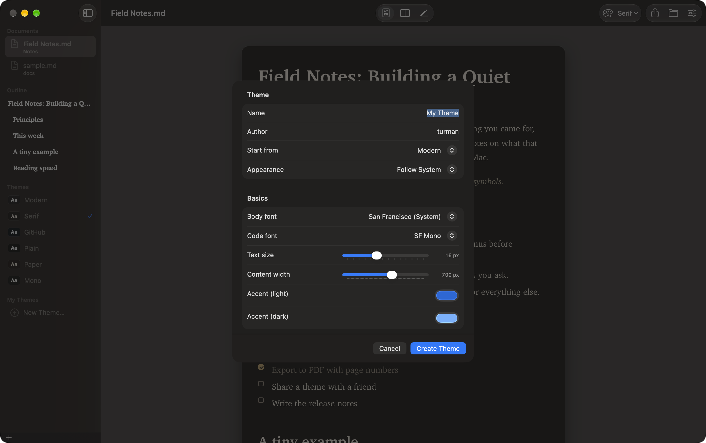

# MarkPeek

**Markdown that looks finished, everywhere on your Mac.**

A free, open-source Markdown viewer and editor for macOS. Press **Space** on any `.md` file in Finder for a themed Quick Look preview, read and edit in a page-like reader with a live split view, pick from six themes or build your own, and export to PDF or HTML that looks exactly like the preview.

Native Swift · Offline · No accounts · No Electron

[](https://github.com/turman17/MarkPeek/releases/latest)
[](https://github.com/turman17/MarkPeek/releases)
[](LICENSE)
[](https://github.com/turman17/MarkPeek/releases/latest)

**[Website](https://turman17.github.io/MarkPeek-website/)** · **[Download](https://github.com/turman17/MarkPeek/releases/latest)**



**Press Space in Finder** for a themed preview, then keep reading or editing in the app:



| Light | Dark |
|---|---|
|  |  |
|  |  |

| Theme inspector | Theme builder |
|---|---|
|  |  |

## Install

**Homebrew**

```bash
brew trust --cask turman17/tap/markpeek
brew install --cask turman17/tap/markpeek
xattr -dr com.apple.quarantine /Applications/MarkPeek.app
```

Homebrew 7 and later only installs casks from taps you trust, hence the first line; skip it on older versions.

**One-line install** (downloads the latest release into `/Applications` and clears the quarantine flag for you; [read the script](scripts/install.sh))

```bash
curl -fsSL https://raw.githubusercontent.com/turman17/MarkPeek/main/scripts/install.sh | bash
```

Or download the latest `.dmg` or `.zip` from [Releases](https://github.com/turman17/MarkPeek/releases), move the app to `/Applications`, and run the same `xattr` command.

> **Why the `xattr` step?** MarkPeek is open source but not notarized (no paid Apple Developer account), so Gatekeeper blocks the first launch. Clearing the quarantine flag once fixes it, or approve the app under System Settings ▸ Privacy & Security ▸ "Open Anyway".

### After installing

1. Launch MarkPeek once. A short setup assistant walks through the permissions below; everything in it can be changed later in Settings or reopened from Help ▸ Welcome Tour….
2. Select any Markdown file in Finder and press **Space**. If the preview shows plain text, enable MarkPeek under **System Settings ▸ General ▸ Login Items & Extensions ▸ Quick Look**, then run `qlmanage -r`.
3. Optional: allow a folder (Settings ▸ General ▸ Images) so documents can show the images stored next to them. The macOS sandbox grants MarkPeek only the file you open; a grant covers the folder and its subfolders and is remembered.
4. Optional: make MarkPeek the default app for Markdown files, from the assistant or Settings.

The app checks GitHub for new releases once a day and can update itself in place (MarkPeek ▸ Check for Updates…).

## Features

**In Finder**

- **Quick Look** previews for `.md`, `.markdown`, `.mdown`, `.mkd`, `.mkdn`, `.mdwn`, `.mdtxt`, `.mdtext`, `.mdx`, `.rmd` and `.qmd`, rendered with your active theme, images included.
- **Thumbnails**: a mini page with the title and first lines for the Markdown types MarkPeek owns (`.mdown`, `.mkd`, `.mkdn`, …). macOS keeps its own text thumbnail for `.md` and `.markdown`.

**In the app**

- **Three modes** (⌘1 ⌘2 ⌘3): a page-card **Preview**, a **Split** view with source on the left and the live preview on the right, and a plain **Edit** view. In Split, the preview updates as you type, the two sides scroll together, and hovering a paragraph highlights it on the other side.
- **Focus Mode** (⌥⌘F): editor only, centered, chrome hidden.
- **Outline** in the sidebar, set in the theme's own font, jumps to any heading. **Find** (⌘F, ⌘G) in preview and editor. **Zoom** (⌘= ⌘− ⌘0).
- **Live reload**: files edited elsewhere update in place; unsaved edits here are kept and you choose Reload or Keep. **Autosave** optional.
- **GitHub-flavored Markdown** via Apple's [swift-markdown](https://github.com/swiftlang/swift-markdown): tables, task lists, strikethrough, nested lists, images, autolinks, heading anchors, raw HTML (with scripts removed).
- **Math and diagrams**: `$…$` and `$$…$$` via MathJax, ```` ```mermaid ```` blocks via Mermaid, bundled offline and inlined only when a document uses them, in the app, exports and Quick Look.
- **Front matter**: a leading YAML block renders as a small table, hidden, or raw (theme option).
- **Syntax highlighting** for fenced code in 17 language families, with optional line numbers and language badges.

**Themes**

- Six built in: **Modern**, **Serif**, **GitHub**, **Plain**, **Paper** and **Mono**, each with light and dark palettes.
- **Theme inspector** (⌥⌘I): fonts, sizes, heading scale and weight, alignment, hyphenation, widths and paddings, radii, light and dark palettes, syntax colors, heading numbering, list markers, table borders and stripes, image options, drop caps, rule styles, and a custom CSS field. Changes show live.
- **Theme builder** (Theme ▸ New Theme…, ⇧⌘N): pick a base, fonts, size, width and accents, then fine-tune.
- **Shareable theme files** (`.markpeektheme`, plain JSON): export, import, double-click to install, or drop into the themes folder. Reference in [docs/THEME-FORMAT.md](docs/THEME-FORMAT.md) and in the in-app **Theme Guide** (Help ▸ Theme Guide, ⇧⌘?), which is rendered with the active theme so it doubles as a preview.

**Export**

- **Export as PDF** (⇧⌘E): paper size, orientation, margins, light or dark, paginated or one long page, page numbers and title header. **Export PDF Next to File** (⌥⇧⌘E) reuses the remembered options.
- **Export as HTML** (⌥⌘E): one self-contained file with the theme, embedded images, and the math and diagram engines when used.
- **Print** (⌘P) uses the same renderer.

## Building from Source

Requirements: macOS 14+, Xcode 16+, Swift 6.

```bash
bash scripts/build-and-install.sh
```

This builds the app and both extensions, signs them, installs to `/Applications`, registers the Quick Look and thumbnail extensions, and resets the Quick Look cache. Signing auto-detects an Apple Development certificate in your keychain (a stable identity keeps folder grants valid across rebuilds) and falls back to ad-hoc; override with `SIGNING_IDENTITY`. The app group is `YJ3UZ772GP.com.markpeek.app.shared`, so a certificate from another team needs the group changed in the three entitlements files and `Shared/ThemeStorage.swift`.

Cut a release with `scripts/release.sh <version>`: it stamps the version, builds, packages the DMG and zip with `scripts/create-dmg.sh` (needs `brew install create-dmg`), writes the cask sha256 into `packaging/homebrew/markpeek.rb`, commits, tags, and can publish the GitHub release. The in-app updater reads GitHub Releases, so that publish is what makes Check for Updates… find the new version.

## Architecture

```
Shared/                           Compiled into the app and both extensions
  Theme.swift                     Theme model (.markpeektheme format, lenient decoding)
  BuiltInThemes.swift             The six bundled themes
  ThemeStylesheet.swift           Theme → CSS (palette as CSS variables) + font catalog
  ThemeStorage.swift              App-group persistence: active theme, theme files
  MarkdownRenderer.swift          swift-markdown → HTML (visitor), front matter, math protection, source-line map, outline
  HTMLSanitizer.swift             Strips scripts, event handlers and javascript: URLs from raw HTML
  SyntaxHighlighter.swift         Dependency-free code highlighting
  ImageEmbedder.swift             Local images → data URIs (with a contained mode for Quick Look)

MarkPeek/                         Host app (SwiftUI)
  App/MarkPeekApp.swift           Scenes, menu commands, file routing
  App/Updater.swift               GitHub Releases check and in-place update
  Models/DocumentModel.swift      Open file, draft, autosave, recents, folder access
  Models/ThemeStore.swift         Library + active theme, edits, import/export
  Views/MainWindow.swift          Sidebar · reader · inspector, toolbar, sheets
  Views/SidebarView.swift         Documents, outline, theme swatches
  Views/ReaderView.swift          Preview / split / editor / welcome, hover sync
  Views/Inspector/                Theme inspector (Type, Layout, Colors, Extras)
  Views/OnboardingView.swift      Setup assistant (Help ▸ Welcome Tour…)
  Views/GuideView.swift           Theme Guide window
  Views/NewThemeSheet.swift       Theme builder
  Views/ExportSheet.swift         PDF options
  Views/SettingsView.swift        Preferences (⌘,)
  Export/PDFExporter.swift        Offscreen WKWebView → paginated or continuous PDF, printing
  Export/HTMLExporter.swift       Self-contained HTML export
  Support/MarkdownWebView.swift   Web view, find/zoom controller, hover-sync bridge
  Support/SourceEditor.swift      AppKit text editor with hover tracking and highlight band
  Support/FolderAccess.swift      Security-scoped folder bookmarks
  Support/ScriptLibrary.swift     MathJax and Mermaid loading
  Resources/vendor/               MathJax and Mermaid bundles
  Resources/Guide/Theme Guide.md  The in-app guide

MarkPeekQuickLook/                Quick Look extension (data-based HTML preview)
MarkPeekThumbnail/                Quick Look thumbnail extension (Finder icons)
MarkPeekTests/                    Unit tests for the shared code

docs/
  THEME-FORMAT.md                 Theme file reference
  sample.md                       Exercises every element
  themes/Dusk.markpeektheme       Example installable theme
packaging/homebrew/markpeek.rb    Homebrew cask template
```

The project uses Xcode's synchronized folders, so new files under `MarkPeek/`, `MarkPeekQuickLook/`, `MarkPeekThumbnail/`, `MarkPeekTests/` and `Shared/` are picked up automatically.

Bundle identifiers: app `com.markpeek.app`, extensions `com.markpeek.app.QuickLook` and `com.markpeek.app.Thumbnail`, theme type `com.markpeek.theme`. The active theme and user themes live in the app group container so the extensions render with the same theme the app shows.

## Testing

```bash
xcodebuild -project MarkPeek.xcodeproj -scheme MarkPeek -destination 'platform=macOS' test
```

`MarkPeekTests` covers theme decoding, the Markdown renderer (including HTML sanitizing and the source-line map) and image embedding. Rendering across the six themes, Quick Look and the exports was validated by hand with `docs/sample.md`; contributions expanding the suite are welcome.

## Contributing & support

Found a bug or want a rendering feature? [Open an issue](https://github.com/turman17/MarkPeek/issues), and see [CONTRIBUTING.md](CONTRIBUTING.md) for how to build and submit changes. Themes worth sharing are welcome in `docs/themes/`.

If MarkPeek makes your Markdown nicer to read, **⭐ star the repo**: it's how other Mac users find it.

## License

MarkPeek is free software, licensed under the [GNU GPL v3.0](LICENSE): you can use, study, modify, and redistribute it, and derivative works must remain open source under the same terms.

Bundled third-party software (full texts in [THIRD_PARTY_NOTICES.md](THIRD_PARTY_NOTICES.md)):

- **swift-markdown 0.9.0** and **swift-cmark** — Markdown parsing, Apache-2.0 and BSD-2
- **MathJax 3.2.2** — math typesetting, Apache-2.0
- **Mermaid 11.4.1** — diagrams, MIT
