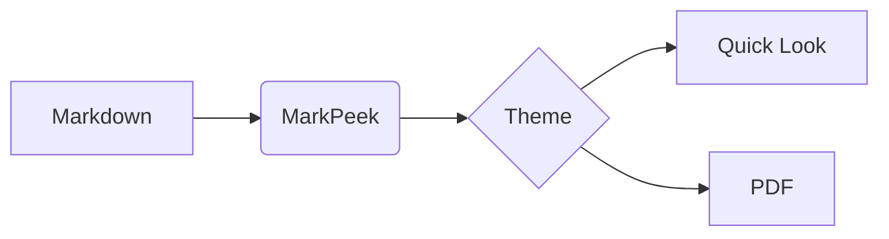

# MarkPeek Sample Document

This file exercises everything a theme can style. Open it in MarkPeek, press **Space** on it in Finder, or export it to PDF to compare themes.

## Text

Regular paragraph with **bold**, *italic*, ~~strikethrough~~, `inline code`, and a [link to MarkPeek](https://github.com/turman17/MarkPeek). Hard line breaks  
work too, and so do automatic links like https://apple.com.

> Reading Markdown should feel like reading, not parsing symbols.
>
> — a blockquote with two paragraphs

### Lists

- Unordered item
- Another item with a nested list
  - Nested item one
  - Nested item two
- Last item

1. Ordered item
2. Second item
   1. Nested ordered
   2. Another
3. Third item

- [x] Task that is done
- [ ] Task still open
- [ ] Another open task

### Code

Inline `let x = 42` and fenced blocks with a language label:

```swift
struct Theme: Codable {
    var name: String
    var typography: Typography
}

let theme = Theme.modern
print(theme.name)
```

```python
import json  # comments are italic

@dataclass
class Theme:
    name: str = "Modern"
    size: int = 16

def load(path: str) -> Theme:
    with open(path) as f:
        return Theme(**json.load(f))
```

```json
{
  "name": "Dusk",
  "formatVersion": 2,
  "elements": { "dropCap": false, "codeLineNumbers": true }
}
```

```sh
# install and register the Quick Look extension
bash scripts/build-and-install.sh && qlmanage -r
export THEME_DIR="$HOME/Library/Group Containers"
```

```
Plain fenced block without a language.
Tabs	and   spaces are preserved.
```

### Math and diagrams

Inline math like $E = mc^2$ and $\sqrt{x_1 + x_2}$ renders in the app and in exports; display math too:

$$
\int_0^1 x^2 \, dx = \frac{1}{3}
$$



### Table

| Theme  | Body font        | Feel               |
|:-------|:-----------------|-------------------:|
| Modern | San Francisco    | Clean, neutral     |
| Serif  | Charter          | Bookish            |
| GitHub | San Francisco    | Familiar, rules    |
| Paper  | Iowan Old Style  | Warm, justified    |
| Mono   | SF Mono          | Terminal           |

### Headings go down to six levels

#### Heading four

##### Heading five

###### Heading six

---


Images next to the document are embedded automatically; remote images load in the app.

Final paragraph after a horizontal rule.
